# Hi — I'm Osman Şahin Güler 👋

**Software Engineering student at Yaşar University — autonomous systems & computer vision, full-stack, applied AI/ML**

<!-- Quick contact & portfolio links -->
- 🌐 Portfolio: [osmansahinguler.com](https://osmansahinguler.com)
- 📄 CV: [Turkish CV](./Osman_Sahin_Guler_CV.pdf) / [English CV](./Osman_Sahin_Guler_CV_Ing.pdf)

---

## Projects

- **[Savaşan İHA — kamikaze mission](https://github.com/HawkOsm/Savasan-IHA-Kamikaze)** — guidance and mission software for an autonomous dive onto a QR target, on ArduPilot and a Jetson. TEKNOFEST 2026 finalist team.
- **[SkySat](https://github.com/deensza/skysat-mlops)** — MLOps around a LoRA-tuned small LLM: queue, GPU training, quality gate, MLflow, serving, drift detection and automatic retraining. Team of two.
- **[Senior Project Management Platform](https://github.com/SE3318-Spring-2025-2026/senior-app-1/pulls?q=is%3Apr+author%3AHawkOsm)** — Node.js, React and PostgreSQL team project; I captained one of its two scrum teams. 28 pull requests, 27 merged.
- **[RSVP Reader](https://github.com/HawkOsm/rsvp-reader)** — speed reader released for web, Linux, Windows, macOS and Android from one TypeScript codebase.
- **[BlackBox](https://github.com/HawkOsm/BlackBox)** — a Linux desktop flight recorder in Rust.
- **[Trend Detective](https://hawkosm.github.io/NASA-Earth-System-Trend-Detective/)** — NASA Space Apps Challenge 2026 entry: a 3D globe of 45 years of climate trends.

---

## Tech stack

  
  
  
  
  
  
  
  
  
  
  

---

## Stats

  
  &nbsp;
  

---

## Get in touch

Looking for a 2027 internship in İzmir or remote.

📫 **Reach out via [osmansahinguler.com/contact](https://osmansahinguler.com/contact)**
