# Hi — I'm Osman Şahin Güler 👋

**Engineering student at Yaşar University — AI/ML / Backend**

<!-- Quick contact & portfolio links -->
- 🌐 Portfolio: [osmansahinguler.com](https://osmansahinguler.com)
- 📄 CV: [Turkish CV](./Osman_Sahin_Guler_CV.pdf) / [English CV](./Osman_Sahin_Guler_CV_Ing.pdf)

---

## Tech stack
<!-- Shields.io badges -->

### 🛠 Languages & frameworks

  
  
  
  
  
  
  
  

### 🧠 AI/ML tools

  
  
  
  
  
  

### 🚀 Deployment & infrastructure

  
  
  
  
  
  

---

## Stats

  
  &nbsp;
  

---

## Get in touch

Looking for a 2027 internship in İzmir or remote.

📫 **Reach out via [osmansahinguler.com/contact](https://osmansahinguler.com/contact)**
